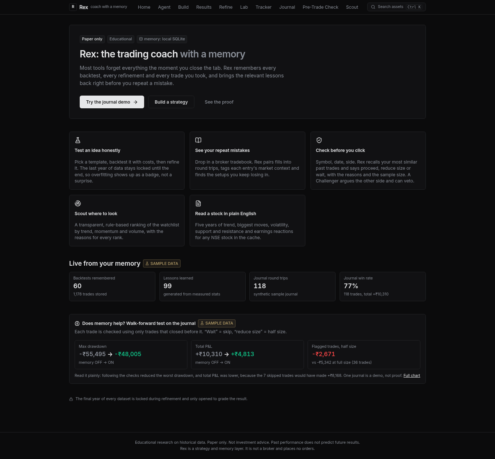
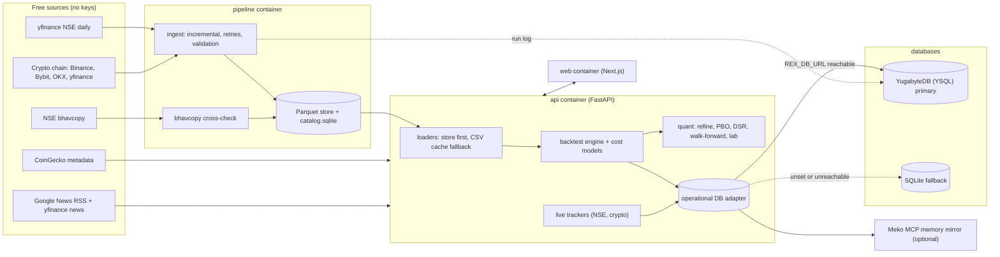
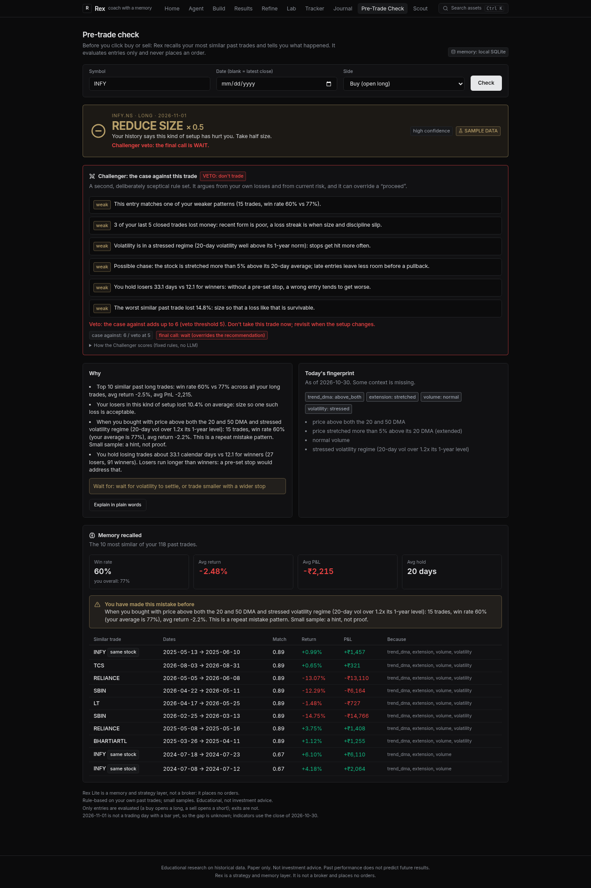
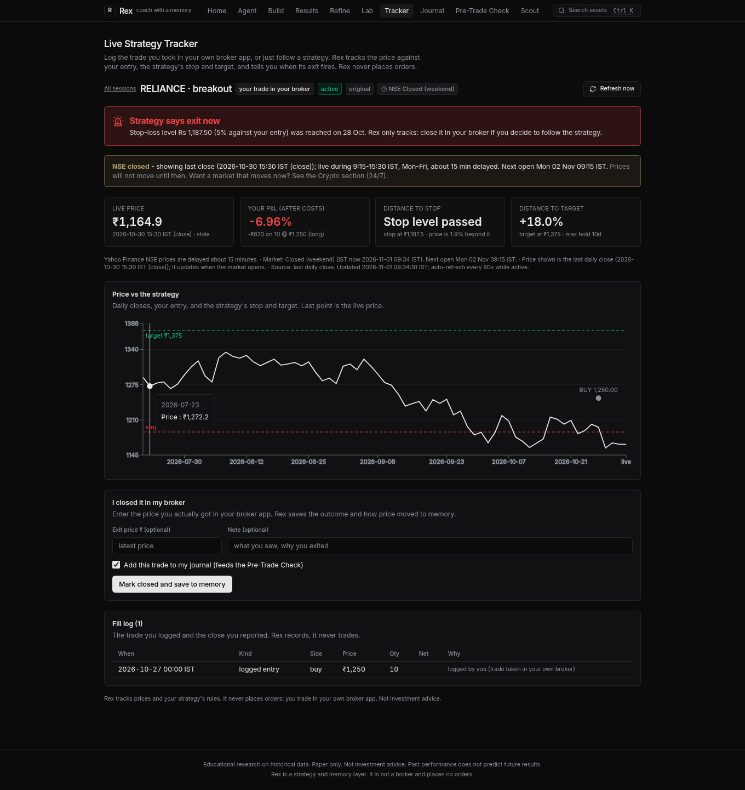

# Rex: the trading coach with a memory

Test an idea, refine it without fooling yourself, find your repeat mistakes from a broker tradebook, and get a proceed / reduce / wait check
before the next trade. Rex remembers every run and lesson. **Educational research on historical data. Paper only. Not investment advice.
Rex is a strategy and memory layer, not a broker: it places no orders.**

## Run it (one command)

    ./start.sh          # API http://localhost:8000/docs  +  UI http://localhost:3000   (first run installs deps and builds)

Needs Python 3.10+ and Node 20+. It runs **offline** by default (`REX_OFFLINE=1`: bundled price cache for 10 NSE stocks and a seeded memory of
about 55 backtests, ~90 lessons, plus a clearly labelled SAMPLE journal). `REX_OFFLINE=0 ./start.sh` fetches live prices from yfinance.
No LLM and no API key are needed (an optional `GEMINI_API_KEY` only improves the plain-English parser). Optional env vars are in `.env.example`.

### Or with Docker (api + web + a data pipeline)

    cp .env.example .env          # optional, everything has defaults
    docker compose up --build     # web http://localhost:3000   api http://localhost:8000/docs
    docker compose exec pipeline python -m pipeline status     # freshness per symbol

Three containers share named volumes (`sqlite`, `store`, `data_cache`): **api** (FastAPI), **web** (Next.js standalone), **pipeline** (keeps the price store fresh). The first start copies the shipped demo memory DB into the empty volume; it never overwrites an existing one. Healthchecks gate the start order (web and pipeline wait for a healthy api). Set `REX_PIPELINE_OFFLINE=1` to seed the store from the bundled cache with no network at all.
`docker compose config -q` is validated in CI; the image build runs there too (`.github/workflows/ci.yml`: pytest, `tsc`, `next build`, compose build). The images were **not** built on the dev box (no Docker daemon there), so the first `docker compose build` on your machine is the real test. The Yugabyte service is likewise untested as a container; the adapter itself was run against a real PostgreSQL server (the same wire protocol, full suite) and against SQLite.

## Architecture

**Databases.** Operational data (strategy-run memory and lessons, tracker sessions, journal, crypto memory, pipeline run log, AI agent runs) goes through one thin adapter, `backend/app/db.py`. With `REX_DB_URL` set (Docker compose sets it) and reachable at start-up it is **YugabyteDB** (YSQL, the PostgreSQL protocol, port 5433); otherwise it is **SQLite**, which is also what the tests use. `GET /health` returns `"db": "yugabyte"` or `"sqlite"`. Schemas are created automatically; a fresh Yugabyte is filled once from the shipped SQLite demo memory (`REX_DB_IMPORT=0` to skip). **Meko** (MCP, optional, `MEKO_TOKEN`) stays a memory mirror next to the database. The Parquet price store and its catalog are not operational data and stay on disk.

Every chart and number in the UI comes from the API; the API computes from stored real prices. Nothing in Rex places an order.

## What is in it

| Page | What it does |
|---|---|
| Home `/` | Pitch, live memory counters, the memory ON vs OFF headline numbers |
| Build `/build` → Results `/results` | **Describe your strategy in plain English** (parsed into the form for you to check), or pick from 4 templates; costs, equity curve vs buy & hold, metrics, trades. A "Rex remembers" card and a **"Last time"** panel (the closest earlier run, what price did next, a one-line lesson) show before you run |
| Refine `/refine` | Grid search on the training years, graded on a **locked final year**: PASSED / OVERFIT badge, original vs refined |
| Tracker `/paper` | **Live Strategy Tracker.** Log the trade you took in your own broker ("I took this trade": ticker, buy/sell, entry, qty, time) or just track a strategy. Rex follows the price vs your entry: P&L, distance to stop and target, and a **"Strategy says exit now"** alert when the strategy's exit rule fires. Closing it saves the outcome to memory. Rex only tracks; it never places orders |
| Journal `/journal` | Upload a tradebook CSV or load the SAMPLE journal; win rate, repeat mistakes, hold-time losers vs winners |
| Pre-Trade Check `/check` | Symbol, date, side → similar past trades, stats, recommendation, Challenger counter-case, memory recalled |
| Research `/research` | Per-stock brief: 5y trend, biggest moves, volatility, support / resistance, earnings reactions (when available) |
| Scout `/scout` | Rule-based ranking of the cached stocks by trend, volume spike and momentum, with reasons |
| Search (Ctrl/Cmd+K) | Global search over 10 NSE stocks and BTC / ETH / SOL (symbol, name, typos). `/asset?symbol=` shows the live price (or last close when NSE is closed), news, coin profile, and quick actions |
| Lab `/lab` | **Strategy Lab:** one strategy on all 13 assets side by side (return, Sharpe, drawdown, trades, verdict), sortable |
| Data `/data` | **Data pipeline:** freshness, validation, active source per symbol, bhavcopy cross-check, run log, manual run |
| Memory `/memory` | Backend status (Meko live vs SQLite), lessons, and the walk-forward **memory OFF vs ON proof** |

More screenshots: `docs/screenshots/` (build, results, refine, tracker, last time, journal, scout, research, memory). Demo script: `docs/DEMO.md`.

## Honest numbers (SAMPLE journal, 118 synthetic round trips on real prices)
Walk-forward, no look-ahead: following Rex's check cut max drawdown from -55,495 to -48,005 and halved losses on flagged trades, but total P&L
fell from +10,310 to +4,813 because 7 skipped trades would have made +8,168. One small synthetic journal is a demo, not proof. See `RESULTS.md`.

## Agents: hire, build, run, deploy (paper)

On `/ai`, **Your agents** has a gallery: hire a preset (Trading Agent, Research Analyst, News Analyst, Risk Manager) or build your own (name, job description, trading or non-trading, asset, and for non-trading agents the tools it may use: price, news, backtest/history, memory). Select a card to make that agent drive the desk.

- **Non-trading agents** write a facts-only report from the existing endpoints (`/crypto/price`, `/assets/quote`, `/news`, `/research/{ticker}`, a simple MA-crossover check, strategy-run memory). They have no deploy option.
- **Trading agents** run the research swarm. After a run that produced a strategy, **Deploy to market** starts a *paper* deployment on the existing live tracker (`POST /ai/versions/{id}/track`): real-time price, signals/alerts and paper P&L since entry. It is labeled "Paper / signals only. No real orders are placed." A Live badge shows on the card; **Stop** calls `POST /ai/watches/{id}/stop`.
- Agents and deployments are stored in this browser (`localStorage`); the watch itself lives in the backend DB.

## Plain-English strategies
On Build, type a strategy ("Buy TCS when the 50 day average crosses above the 200 day, 4% stop, hold 3 weeks"), press **Parse**, check the parsed-rules card and the filled form, then **Run backtest**. Nothing runs until you click.
`POST /strategies/parse {"text": "..."}` returns `{strategy, confidence, assumptions[], unsupported[], parser}`. `strategy` has the same shape `/backtest` accepts, and is `null` when no supported entry rule is found.
- **Parser:** with `GEMINI_API_KEY` set, Gemini (default `gemini-3.6-flash`, fallback `gemini-3.1-flash-lite`, JSON-schema output) reads the text. Its answer is then re-validated against the template registry, and a number is accepted only if it literally appears in your text. Without a key, or if Gemini fails, a deterministic keyword/regex parser covers every template, exit and the 10 cached NSE symbols. The core app never needs a key.
- **Never invents:** anything Rex Lite cannot test (short selling, options, MACD/Bollinger, volume or candlestick rules, trailing stops, intraday, date ranges, other stocks, indicator-based exits) is listed under "Not supported" and is not silently dropped or approximated. Defaults are listed as assumptions.
- Responses are cached by text hash.

## Live Strategy Tracker and strategy-run memory
**Tracker** (`/paper`, also a "Track this strategy live" card on Results and Refine). Two modes: *your trade* (you logged it; Rex only alerts and never closes it for you) and *no trade* (Rex follows the strategy's own entry and exits, labelled paper). Both use the **same exit engine as the backtest** (stop checked before target, gap checks, hold limit; tests prove they match; shorts are supported for logged trades).
A background loop refreshes every `REX_TRACK_INTERVAL` seconds (default 60; `REX_TRACKER_LOOP=0` turns it off), persists in SQLite, and survives restarts. Yahoo's NSE feed is about 15 minutes delayed and the page says so. NSE hours are 09:15 to 15:30 IST; outside them (or offline) Rex shows the last close, labelled with the market state and next open.
Closing a session saves the outcome and how price moved to memory (SQLite, mirrored to Meko when a token is set); optionally the trade also goes into your journal, which then feeds the Pre-Trade Check (once the journal has real trades the check uses only those, not the SAMPLE ones).

    POST /paper/start            {ticker, template, params, exits, cost_bps}  or  {..., trade:{side, entry_price, qty, entered_at}}
    GET  /paper/sessions         list    GET /paper/{id}[?refresh=1]   live view    POST /paper/{id}/refresh
    POST /paper/{id}/stop        {exit_price?, note?, add_to_journal?}   saves the outcome

**Strategy-run memory.** Every backtest, refine and tracker session is saved with its parameters and verdict. Forward returns over the next 5 and 20 trading days are computed from real closes once those bars exist. Before a new backtest of a similar strategy, Build shows **Last time** plus a one-line rule-based lesson. A fresh install is seeded with 80 *replayed* runs (real data cut off at an earlier date, labelled "replayed from real data", never mirrored to Meko).
`GET /memory/strategy-runs?ticker=&template=&limit=` returns `{count, total, runs[], last_time}`.
Limits: Yahoo intraday is delayed and can be rate-limited (Rex then falls back to the last close, labelled); NSE holidays are not modelled; a hold-limit exit on a still-forming bar fires only at the close.

## Crypto (separate section, BTC / ETH / SOL)

A purely additive **Crypto** area (nav: Crypto) next to the NSE features; nothing in the NSE flow changed. It has its own Build (same plain-English parser, coin picker, 1d / 4h / 1h candles), Results, Refine (locked final period: last 365 days on daily, last ~20% of candles on intraday), Crypto Tracker and "Last time" memory (`crypto_runs`, kept apart from NSE runs).

- **Data:** Binance public REST (`api.binance.com` `/api/v3/klines` and `/ticker/price`, no key), falling back to `data-api.binance.vision`, then yfinance. History is cached in `backend/data_cache/crypto/`. Live Binance was checked from the dev box and from a Mac: it works. If your network geo-blocks Binance, Rex falls back and labels the data "Not live (cached)".
- **Real-time:** the price strip and tracker poll every 3 s and show "updated Ns ago". Crypto is 24/7, so there is no open/closed state. Times are UTC. Default cost 10 bps.
- **Tracker:** log "I took this trade on my exchange" or track the strategy. Live P&L, distance to stop/target, a "Strategy says exit now" alert and a live chart with entry/exit/stop/target markers. **Rex never places orders.**
- **Env:** `REX_CRYPTO_OFFLINE=1` (no network, cache only), `REX_CRYPTO_LOOP`, `REX_CRYPTO_TRACK_INTERVAL` (server loop, default 10 s).
- **NSE closed-market state:** the stock tracker now shows a prominent banner when NSE is closed ("showing last close; live 9:15-15:30 IST, about 15 min delayed").

## Data pipeline (`backend/pipeline`)
Prices live in a Parquet store (one file per `market/symbol/interval`) with a SQLite catalog (`partitions`, `runs`, `run_items`). The app reads the store first and falls back to the bundled CSV cache, so nothing breaks when the store is empty.

    cd backend
    python -m pipeline seed          # import the bundled cache, no network
    python -m pipeline run           # one incremental ingest (--market nse|crypto|all)
    python -m pipeline status        # freshness per symbol (--json)
    python -m pipeline crosscheck    # compare stored NSE closes with the NSE bhavcopy
    python -m pipeline validate      # re-validate every stored partition
    python -m pipeline schedule      # long-running: NSE weekdays 16:05 IST, crypto hourly at :02 UTC (what the compose service runs)

Ingest is incremental (only bars after the last stored one), retried with exponential backoff, and every batch is validated (duplicates, gaps, OHLC sanity, non-positive prices, stale last bar); rows that fail are dropped and counted, never silently kept. One bad symbol never fails a run. `REX_STORE` picks the store directory. API: `GET /pipeline/status`, `/pipeline/runs`, `POST /pipeline/run`, `GET|POST /pipeline/crosscheck`; UI: `/data`.

## Free data sources and fallbacks
All free, none needs a key. The first source in a chain that answers wins, and the Data page shows which one served each symbol (and why earlier ones were skipped).

| Data | Chain | Notes |
|---|---|---|
| NSE daily | yfinance (primary) | Cross-checked against the NSE **bhavcopy** (`sec_bhavdata_full`, the exchange's official close): last 3 stored sessions, 0.5% tolerance. yfinance closes are split/dividend adjusted, so only recent sessions are compared. Skipped quietly if NSE is unreachable; never fails a run |
| Crypto candles | Binance (`api.binance.com`, then `data-api.binance.vision`) → Bybit v5 spot → OKX → yfinance | Only confirmed candles are stored |
| Coin profile | CoinGecko free API | Metadata only (name, rank, market cap, supply, ATH), cached 6 h. Never prices |
| News | Google News RSS + yfinance news | Headline, publisher, time, link out. **No sentiment is computed**; Rex says so on the page |

`REX_NEWS_OFFLINE=1` switches off news and CoinGecko calls (tests set it). `REX_OFFLINE` / `REX_CRYPTO_OFFLINE` / `REX_PIPELINE_OFFLINE` switch off price network calls.

## Quant suite
- **Overfitting check on Refine** (`overfit_stats` in the `/refine` response). *PBO*, the Probability of Backtest Overfitting (Bailey, Borwein, López de Prado, Zhu: CSCV): the search's return matrix is cut into 16 blocks; for all 12,870 half/half splits the best in-sample candidate is ranked out of sample; PBO = share of splits where that winner lands in the bottom half. <20% low, 20 to 50% moderate, >50% high. A single PBO is noisy (on pure noise it swings widely but averages about 50%). *DSR*, the Deflated Sharpe Ratio (Bailey and López de Prado, 2014): the chance the true Sharpe beats what luck alone would produce after N trials, adjusted for skew and fat tails; 95% or more is the usual bar. Both are shown with a plain-English reading, and both use the training period only.
- **Walk-forward** (`POST /walkforward`, `POST /crypto/walkforward`; Refine page tab). Rolling or anchored windows: tune on the train window only (best train Sharpe, at least 5 trades), trade the next unseen window, slide, repeat. Defaults: train 2 years, test 1 year. Output: stitched out-of-sample equity (with window boundaries), per-window train vs test table, efficiency (OOS Sharpe / mean in-sample Sharpe) and a verdict (holds / fails / inconclusive).
- **Strategy Lab** (`POST /lab/run`, page `/lab`). The same rules, exits and costs on 10 NSE stocks + BTC, ETH, SOL (daily). Verdicts use the locked final window: *holds*, *fades*, *loses money*, *few trades* (<10).
- **Realistic Indian cost model** (optional; `cost_model` = `bps` | `india_delivery` | `india_intraday`, plus `slippage_bps` and `trade_value`). Per-leg costs as a fraction of trade value, from Zerodha's published charges (https://zerodha.com/charges/, checked 2026-11-01; rates change, edit `RATES` in `backend/app/costs.py`):

| Item | Delivery | Intraday |
|---|---|---|
| Brokerage | 0 | min(₹20, 0.03%) per order |
| STT | 0.1% on buy and sell | 0.025% on sell only |
| NSE transaction charge | 0.00307% both legs | 0.00307% both legs |
| SEBI fee | ₹10 / crore both legs | ₹10 / crore both legs |
| GST | 18% of (brokerage + SEBI + transaction charge) | same |
| Stamp duty | 0.015% on buy | 0.003% on buy |
| DP charge | ₹15.34 on each sell | none |
| Slippage | your assumption, default 5 bp per leg | same |

  Default trade size ₹1,00,000. Hand-checked: delivery = 23.78 bp round trip + 10 bp slippage = 33.78 bp; intraday = 18.27 bp including slippage. `GET /costs/models` returns the breakdown, rates and source. Crypto keeps its flat bps fee; the Indian models do not apply to it.

Other endpoints: `GET /assets/search?q=`, `/assets/quote?symbol=`, `/assets/meta?symbol=`, `/news?symbol=`.

## Memory backends
SQLite is always the source of truth. With `MEKO_TOKEN` set, lessons and journal patterns are also mirrored to **Meko** over MCP
(`conversation_create`, `memory_add`, `memory_search`; verified against the live server on 1 Nov 2026) and recalled on the check page.
Optional "Explain" buttons use `GROQ_API_KEY` or `GEMINI_API_KEY` (default model `gemini-3.6-flash`) and are hidden without a key.

## Layout
    backend/   FastAPI + SQLite (app/, tests/ = 300+ offline tests, audit/ = independent reference backtester + audit scripts, examples/ = real API responses, data_cache/ = bundled prices)
    web/       Next.js 16 + Tailwind v4 + shadcn-style UI + Recharts
    pipeline/  (under backend/) Parquet store, providers, ingest, scheduler, cross-check
    start.sh   one-command start       MASTER_PROMPT.md  the build brief       RESULTS.md  measured results

Persona QA with real-data numbers: [docs/PERSONA_QA.md](docs/PERSONA_QA.md).
Accuracy audit (independent pandas reference, 80 runs, 0 mismatches): [docs/ACCURACY_AUDIT.md](docs/ACCURACY_AUDIT.md).

Tests: `cd backend && python3 -m pytest -q` · Typecheck: `cd web && npm run lint` · Build: `cd web && npm run build`.
MIT licensed.
