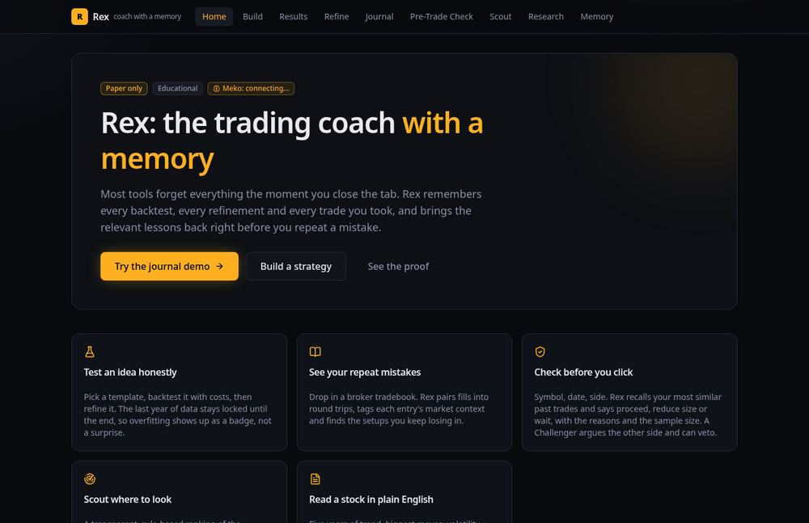

<!-- MLH DEV write-up. Fill in the repo and demo links before publishing. Set published: true on DEV when ready. -->

For HackCBS 9.0 I built **Rex**, a trading coach with a memory. It backtests your idea honestly, learns from your own past trades, and tells you *proceed, reduce size or wait* right before you repeat a mistake. This post is about how it works, how I wired it to **Meko** (agent memory over MCP), and an uncomfortable result I decided to keep.

> Educational project on historical data. Paper only. Not investment advice.



## The problem I wanted to attack
Two failure modes show up again and again for retail traders:

1. **You repeat yourself.** The setup that hurt you last month looks fine in the moment.
2. **Optimised strategies overfit.** Try 400 parameter sets, keep the best, and it shines on the data you tuned on.

Rex's refine step runs a grid search on the training years and then grades the winner on a **locked final year**. In my own examples, RELIANCE breakout went from Sharpe 0.46 on training to 0.14 on the locked year, and TCS mean-reversion from 0.80 to −1.25. Both are stamped **OVERFIT**. The tool tells you instead of hiding it.

## Architecture
```
Next.js UI  ->  FastAPI  ->  SQLite (source of truth)
                   \-----> Meko MCP (mirror + recall)
```
- Prices are real yfinance daily bars, cached so the whole demo runs offline.
- The journal importer pairs fills into round trips and gives each entry a five-part **fingerprint**: trend vs the 20/50-day averages, stretch above the 20-day, volume spike, volatility regime and opening gap.
- The pre-trade check finds your most similar past entries, compares their win rate to your overall win rate, and applies a small set of tested rules to return proceed / reduce / wait with the sample size.
- A **Challenger** collects weighted arguments *against* the trade and can veto it (weights add up to 5 or more).
- Every recommendation is rule-based. There is no LLM in the decision path.

## Wiring up Meko
SQLite is always the source of truth. If a `MEKO_TOKEN` is set, Rex also mirrors backtest summaries, lessons and journal patterns to Meko and recalls them on the check page. I built against the live server from the start (42 tools). A few things I would have gotten wrong with a mock:

- Every memory call needs a **`conversation_id`**, so you call `conversation_create` first.
- `memory_add` takes `metadata` as a **JSON string**, not an object.
- `memory_search` is **cross-agent**, so I filter results to my own `agent_id`.
- `memory_search` took **7 to 18 seconds** in my tests, so the UI loads recall in the background and never blocks the decision.

```python
# simplified: write, then recall
conv = await s.call_tool("conversation_create", {"agent_id": "rexlite", "title": "rex"})
await s.call_tool("memory_add", {"text": lesson, "conversation_id": cid,
                                 "agent_id": "rexlite", "metadata": json.dumps(meta)})
hits = await s.call_tool("memory_search", {"query": q, "conversation_id": cid})
```
Every Meko call is best effort: a failure is shown in the status chip and never breaks the app. Sample data is never mirrored, so the demo cannot pollute a real memory store.

## Does memory actually help? I tested it
I wrote a walk-forward test: for each trade in a 118-trade journal, apply Rex's check using only trades that closed *before* it. "Wait" means skip, "reduce" means half size.

| | P&L | Max drawdown | Win rate |
|---|---|---|---|
| Memory OFF (take everything) | +10,310 | −55,495 | 77.1% |
| Memory ON | +4,813 | −48,005 | 76.6% |

Drawdown improved by about 13%. **Total P&L went down**, because the 7 trades Rex told me to skip would have made +8,168. Reduced trades lost 5,342 at full size and 2,671 at half size.

I could have tweaked thresholds until the chart looked better. I did not. The honest reading: on this one synthetic journal the check behaves like a risk reducer, not a return booster. The journal is synthetic behaviour on real prices, so this demonstrates the mechanism and proves nothing about edge. The home page says exactly that.

## Testing and quality
106 pytest tests with hand-built fixtures (exit logic, fill pairing, the proceed/reduce/wait rules, the Challenger, Meko falling back to SQLite on a bad token), a TypeScript check, a production build, and a headless Chrome click-through of every page with no console errors or warnings.

## What I'd do next
Scout, Researcher and Challenger are deterministic rules today. Next: a News agent, a Risk & Coach agent, lessons promoted into Meko's shared memory so agents learn from each other, paper trading, then crypto and prediction markets.

## Takeaways
- Put memory where the decision happens, not in a separate "history" tab.
- Report negative results. They are the most credible part of the demo.
- Build against the real API early. The sharp edges were where the learning was.

Repo: `[add link]` · Demo: `[add link]` · Run it with `./start.sh`.
